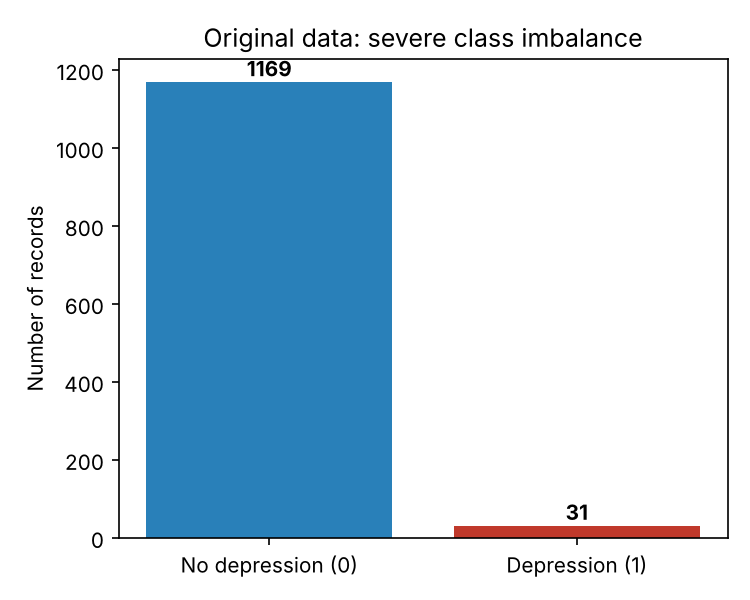
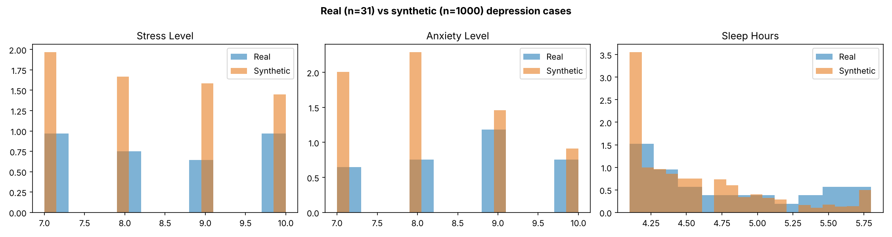
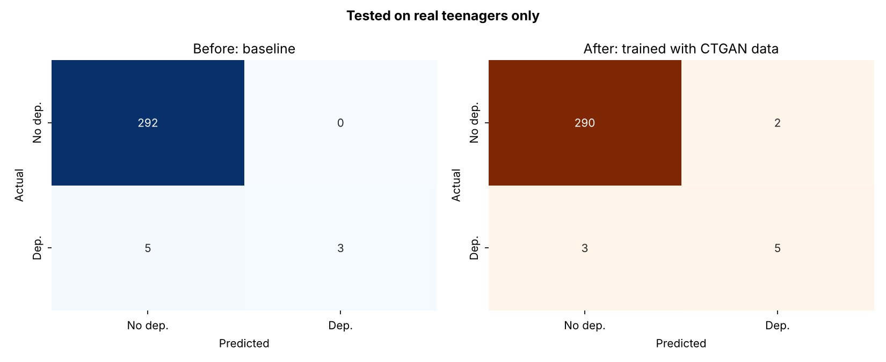

# Synthetic Data with CTGAN for a Rare Class (Teen Mental Health)

Only **31 out of 1,200** teenagers in this dataset have depression (2.6%). A normal model trained on this data misses most of them. In this project I use **CTGAN**, a generative AI model, to create synthetic depression cases and check whether they help a model find real ones.

I also found a **data leakage mistake** in my first attempt, so this repo shows both versions and what I learned from fixing it.



## What I did

1. Trained a baseline **Logistic Regression** model on the original data
2. Trained **CTGAN** (from the SDV library) on the depression cases to generate synthetic ones
3. Checked that the synthetic data looks like the real data (means, spread, histograms)
4. Retrained the model with the synthetic data and compared the results



## Two versions

| Notebook | Method | Test set |
|---|---|---|
| [01_original_approach_with_leakage](notebooks/01_original_approach_with_leakage.ipynb) | Added synthetic data **before** splitting into train/test | Mostly synthetic depression cases ⚠️ |
| [02_corrected_approach](notebooks/02_corrected_approach.ipynb) | Split the real data **first**, made synthetic data from the training set only | **Real teenagers only** ✅ |

## Results

| Recall for depression | Baseline | With CTGAN |
|---|---|---|
| Version 01 (leaky test set) | 0.375 | 0.96 ⚠️ |
| **Version 02 (real test set)** | **0.375 (3 of 8)** | **0.625 (5 of 8)** |

In the corrected version, tested on real teenagers only:

| Metric (depression class) | Baseline | With CTGAN |
|---|---|---|
| Recall | 0.375 | **0.625** |
| Precision | 1.000 | 0.714 |
| F1-score | 0.545 | **0.667** |



**CTGAN helped:** the model found 5 of the 8 real depression cases instead of 3, with only 2 false alarms. But the honest improvement is smaller than my first version showed.

## What I learned

- **Data leakage can make results look much better than they are.** In my first version, 250 of the 258 depression cases in the test set were synthetic. The model was tested on data that looked just like its training data, so recall jumped to 0.96. The fix is to split first and keep the test set 100% real.
- **Accuracy is misleading with rare classes.** The baseline had 98% accuracy but missed 5 of 8 depression cases.
- **Synthetic data has trade-offs.** It raised recall but also added false alarms.
- **Small test sets are not stable.** With only 8 real depression cases in the test set, one more or one less correct answer changes recall a lot. Results also change a little each time CTGAN is trained. Cross-validation or a bigger dataset would give a more reliable answer.

## How to run it

1. Download the dataset (see [data/README.md](data/README.md))
2. Install the libraries and open the notebooks:

```bash
pip install -r requirements.txt
jupyter notebook
```

## Tools

Python · pandas · scikit-learn · SDV (CTGAN) · PyTorch · matplotlib · seaborn

## Author

**Aliaa Farag**, early childhood teacher moving into data analytics, Auckland, New Zealand
[LinkedIn](https://www.linkedin.com/in/aliaafarag) · [More projects](https://github.com/draliaa81-sys)

*This is a learning project with a public dataset. It is not a tool for diagnosing mental health.*
